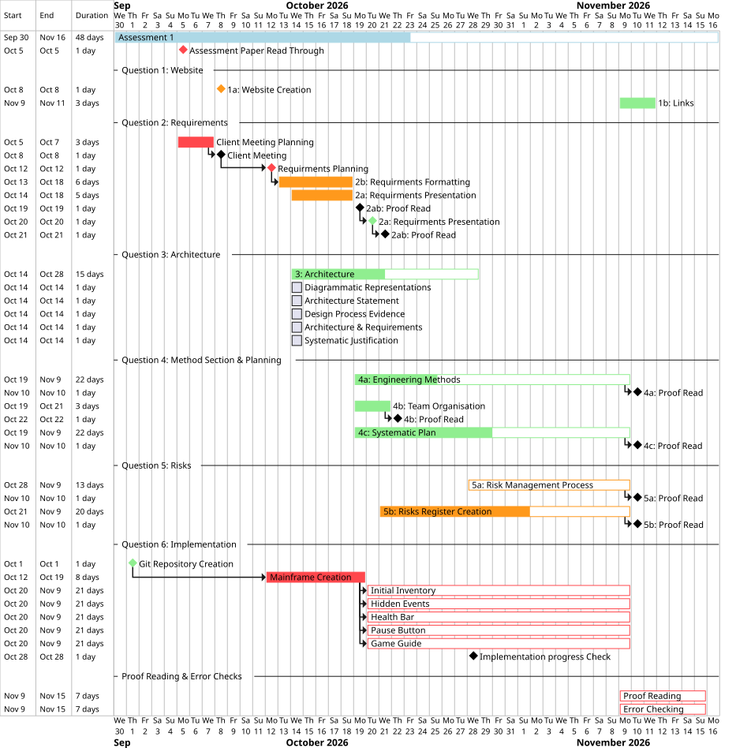
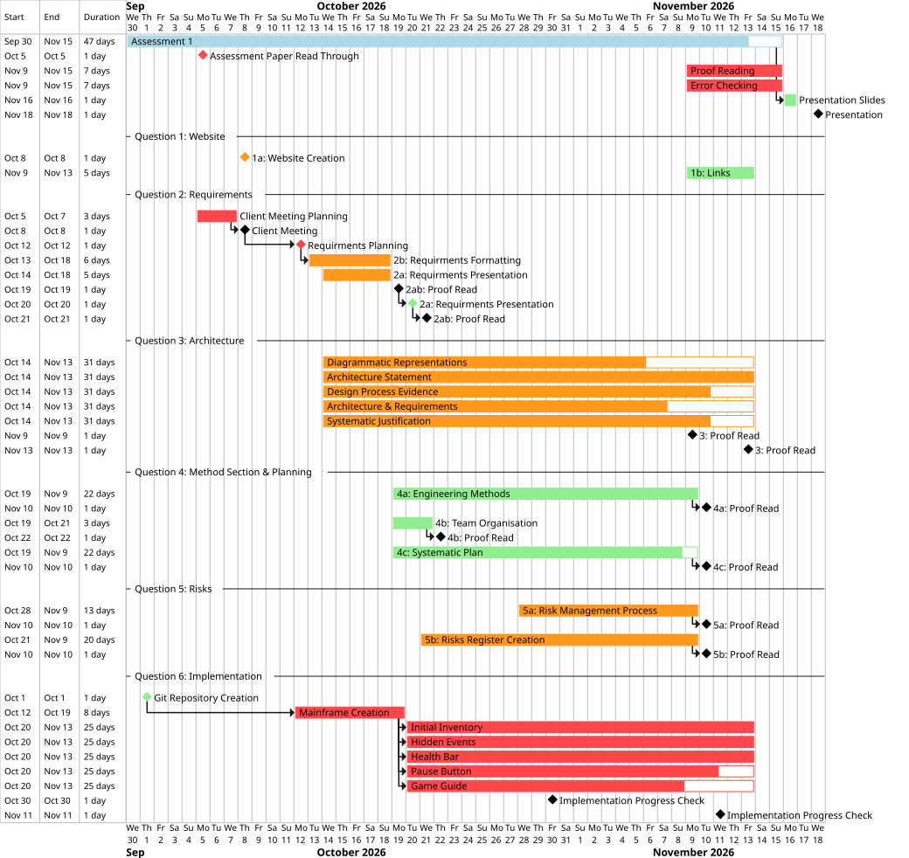

# Engineering 1 Cohort 3 Group 5

Requirements: 
https://1drv.ms/w/c/7fa17625c5292594/IQCdI5-MBPoSQYalD5_pwZYeAcDEG7F-q2FFqg2bZ-ZvCZc

Architecture: https://docs.google.com/document/d/1TzoM5JcSVfVxfLRR8gTkypFC0vH2wr5XmEeu74xXAIM/edit?usp=sharing

Planning:
https://1drv.ms/w/c/7fa17625c5292594/IQCgBTZxgBKoQ4Dck7KU4-34AbtHbHvkYn6y1CVlmaSXqL4

Risks: https://1drv.ms/w/c/7fa17625c5292594/IQBGFWIc7tadQZSVLs3F3gJzAXYqDUIO2bl8fzRSZjjzQkk

Implementation:
https://1drv.ms/w/c/7fa17625c5292594/IQBUf3i1slJoR5Jk1UgFSk7ZAV8dooOp5IympQ7pVdRm9ok

Executable: https://drive.google.com/file/d/19nDViV6C7VD-k0ZjX1I2tCjfkpN74QZX/view?usp=drive_link

Repository: https://github.com/Engineering-1-Cohort-3-Group-5/Eng1C3G5.github.io/tree/main

## Additional Material

### Risk Matrix

### Question 4: Project Plan
#### Week 1 Project Plan

#### Week 4 Project Plan

#### Week 7 Project Plan

