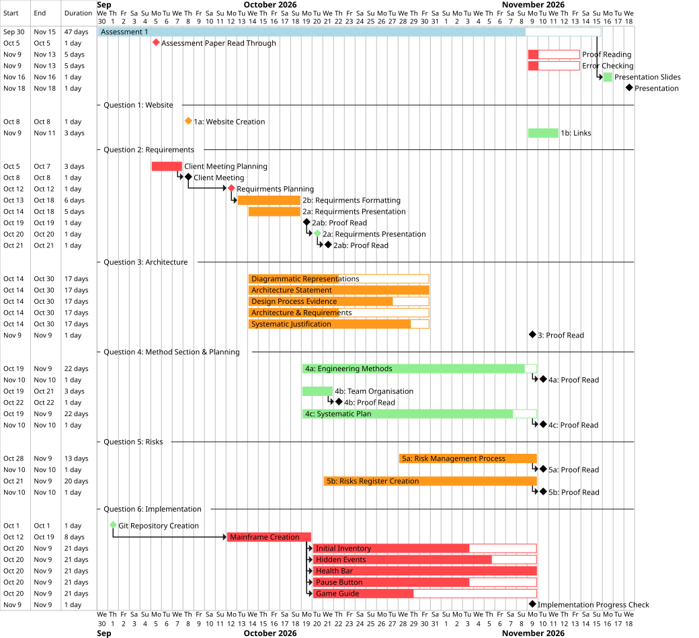

# Engineering 1 Cohort 3 Group 5

Requirements: https://docs.google.com/document/d/1yeaoK_1mfQn3LMuJTKoRhyuUO1CuMTIVL0JHH_UibGg/edit?usp=sharing

Architecture: https://docs.google.com/document/d/1TzoM5JcSVfVxfLRR8gTkypFC0vH2wr5XmEeu74xXAIM/edit?usp=sharing

Planning:

Implementation: https://docs.google.com/document/d/1EDezyeblVpin3uCbS8wvbFe_BrENXD-KVbQLoCv0iJY/edit?usp=sharing

Risks: https://docs.google.com/document/d/1OQcT9GZBgtdByeZ4WNBoPyWrezSevrTCJko1J7j-QE0/edit?usp=sharing

Executable:

Repository: https://github.com/Engineering-1-Cohort-3-Group-5/Eng1C3G5.github.io/tree/main

## Additional Material

### Risk Matrix

### Question 4: Project Plan
#### Week 1 Project Plan

#### Week 4 Project Plan

#### Week 6 Project Plan

