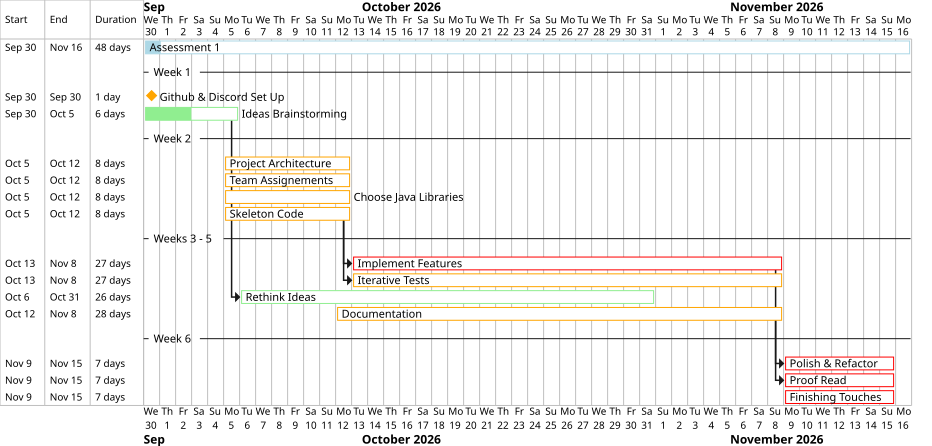
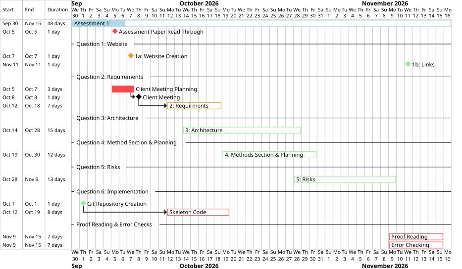
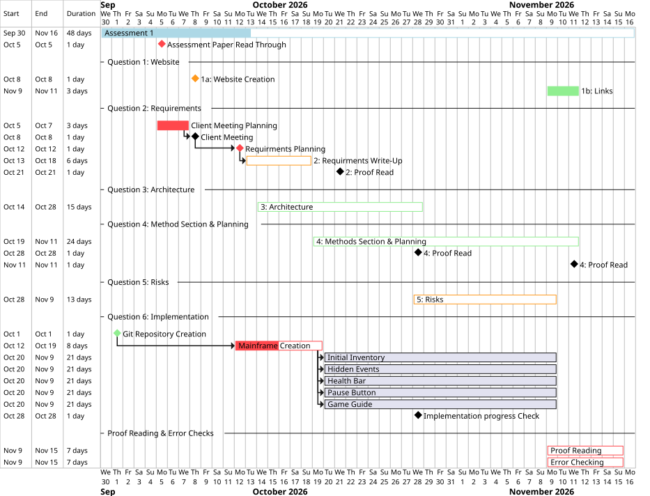
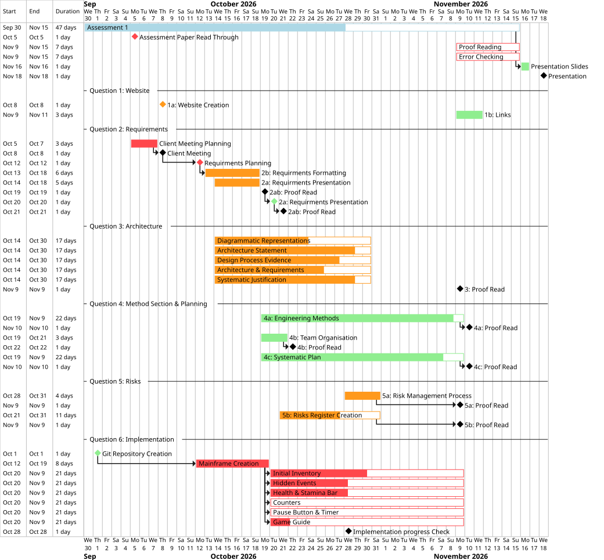

# Engineering 1 Cohort 3 Group 5

### PDF Documents

2. [Requirements](Documentation/Req1.pdf)

3. [Architecture](Documentation/Arch1.pdf)

4. [Planning](Documentation/Plan1.pdf)

5. [Risks](Documentation/Risk1.pdf)

6. [Implementation](Documentation/Impl1.pdf)

### Executable: [Jar File](Documentation/en1-goose-game-1.0.0.jar)

### Repository: https://github.com/Engineering-1-Cohort-3-Group-5/Eng1C3G5.github.io/tree/main

## Additional Material

### Question 3: Architecture Diagrams
[Architecture Diagrams PDF](./ArchitectureOldDiagrams.pdf)

### Question 5: Risk Matrix

### Question 4: Weekly Plans
#### Week 1 Project Plan

#### Week 2 Project Plan

#### Week 3 Project Plan

#### Week 4 Project Plan

#### Week 5 Project Plan

#### Week 6 Project Plan

